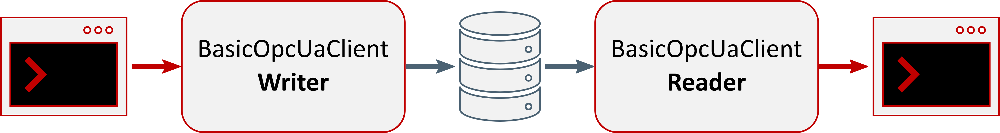

Prerequisites
=============

The example runs with Docker Compose.
These images are published on Docker Hub and are pulled automatically:

* ``ait1/lablink-opcua-client:latest``
* ``ait1/lablink-config-server:latest``
* ``eclipse-mosquitto:2``

Example: Reading from and writing to an OPC UA server
=====================================================

In this example, two instances of class *BasicOpcUaClient* are used to write/read data from/to an OPC UA server:

* One client is configured to only write values to the server.
  Via the console, the user can set new values to the client's data services, which will be written to the associated variables on the OPC UA server.
  (In a realistic setup, the data services would receive data from other Lablink clients.)
* The other client is configured to only read values from the server.
  In the console, new values are displayed every time on of the associated variables changes on the OPC UA server.
  (In a realistic setup, the data services would be sent to other Lablink clients.)

The example setup is configured via the Compose file at :github_blob:`examples/docker-compose.yml <examples/docker-compose.yml>`.
The OPC UA server image is built from :github_tree:`examples/opcua <examples/opcua>`.
Using a local clone of the repository, change to folder `examples` and start the configuration server, the broker, and the OPC UA server by running:

.. code-block:: bash

   docker compose up -d

.. note:: Once the example is running, the available configurations are listed at http://localhost:10101.

.. seealso:: A convenient tool for viewing the content of the configuration database file (and editing it for experimenting with the example setup) is `DB Browser for SQLite <https://sqlitebrowser.org/>`_.

Start each client shell in its own terminal, from the same directory:

.. code-block:: bash

   docker compose run --rm writer

.. code-block:: bash

   docker compose run --rm reader

.. note:: The order in which the two shells are started is not important.

Once the write-only client client starts up, the client shell can be used to interact with the OPC UA server.
To start with, you can type ``ls`` to list all available data services:

.. code-block:: doscon

   llclient> ls
   Name            DataType                State
   xds     Double  0.0
   xluis   Long    0
   xlis    Long    0
   xbs     Boolean false
   xluil   Long    0
   xlil    Long    0
   xlui    Long    0
   xld     Long    0
   xli     Long    0
   xdb     Double  0.0
   xdd     Double  0.0
   xbb     Boolean false
   xdf     Double  0.0
   xbd     Boolean false
   xdi     Double  0.0

You can use the console to change the values of these data services, which will cause the associated variable on the OPC UA server to be updated accordingly.
For instance, data service ``xdf`` expect an input of type ``Double`` and will write this value to the OPC UA server variable with node ID ``LablinkTest/ScalarTypes/LlTestFloat``.
To update the value of this data service, use command ``svd``:

.. code-block:: doscon

   llclient> svd xdf 12.34
   Success

After a short delay, all the read-only client's data services subscribed to OPC UA server variable ``LablinkTest/ScalarTypes/LlTestFloat`` will receive the corresponding value.
When this happens, you should see log outputs in the client's console similar to the following:

.. code-block:: doscon

   19:01:52.459 [milo-shared-thread-pool-0] INFO  OpcUaClientBase - subscription value received: item=NodeId{ns=2, id=LablinkTest/ScalarTypes/LlTestFloat}, value=Variant{value=12.34}, handle=1
   19:01:52.464 [milo-shared-thread-pool-0] INFO  OpcUaClientBase - subscription value received: item=NodeId{ns=2, id=LablinkTest/ScalarTypes/LlTestFloat}, value=Variant{value=12.34}, handle=10
   19:01:52.469 [milo-shared-thread-pool-0] INFO  OpcUaClientBase - subscription value received: item=NodeId{ns=2, id=LablinkTest/ScalarTypes/LlTestFloat}, value=Variant{value=12.34}, handle=14

To check the actual value of the data services, you can again type ``ls``.
You will see that the value of ``12.34`` has been received by several data services, with the value cast accordingly to the service's data type:

.. code-block:: doscon

   ysf     String  12.34
   ylf     Long    12
   ydf     Double  12.34000015258789

Note that the casting of the original value to data type ``Long`` and ``Double`` causes rounding errors!
Hence, using the appropriate data type is always advisable ...
